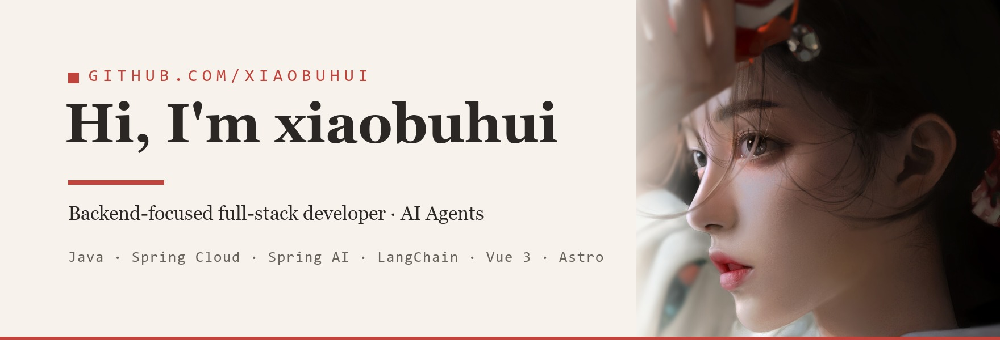
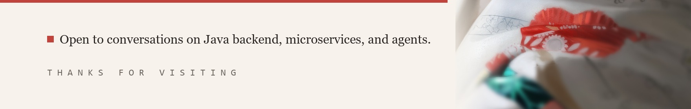

  <a href="./README.md">简体中文</a> · <b>English</b> · <a href="./README.zh-TW.md">繁體中文</a> · <a href="./README.ja.md">日本語</a> · <a href="./README.ko.md">한국어</a> · <a href="./README.ru.md">Русский</a> · <a href="./README.es.md">Español</a> · <a href="./README.fr.md">Français</a> · <a href="./README.de.md">Deutsch</a> · <a href="./README.pt.md">Português</a>

  
  

I am an undergraduate student and a backend-focused full-stack developer. I write code outside of class hours, and most of the projects in this account were built that way.

Backend is my strongest area. I started with SSM and have since worked through Spring Boot and Spring Cloud, applying service discovery, API gateways, and distributed transactions in real projects.

My current focus is AI applications and agent development. My primary tools are Spring AI, LangChain, and LangGraph, with Python / FastAPI for implementation.

On the full-stack side I can deliver frontend and backend independently. I work mainly with Vue 3 / Astro, together with TypeScript and Tailwind CSS, and can take a feature from API to interface.

---

## What I'm doing

Most of my time currently goes into agent development: studying the fundamentals such as tool calling, RAG, and evaluation, while building working prototypes in Python.

Two of my more complete projects were built from scratch with a separated frontend and backend. CloudShopping is a B2C e-commerce platform on Vue 3 and Spring Cloud Alibaba, covering Nacos service discovery, Dubbo remote invocation, and Seata distributed transactions. LiangtianDigitalFarm is a smart agriculture platform on Spring Boot 3, covering the full planting-to-sales workflow with IoT-based environmental monitoring and remote control.

I also maintain a personal Astro blog for technical notes.

---

## Tech stack

| Area | Stack | Focus |
| --- | --- | --- |
| AI / Agent | `Spring AI` `LangChain` `LangGraph` `LangSmith` `Python` `FastAPI` | Primary focus |
| Backend | `Java` `Spring Boot` `Spring Cloud` `MyBatis-Plus` `Dubbo` | Core strength, multiple complete projects |
| Middleware | `Nacos` `Seata` `RocketMQ` `Redis` `Sentinel` `Elasticsearch` | Hands-on configuration in real projects |
| Database | `MySQL` `Redis` `SQLite` | Design and usage |
| Frontend | `Vue 3` `Astro` `Svelte` `TypeScript` `Tailwind CSS` | Independent frontend-to-backend delivery |
| DevOps | `Linux` `Docker` `Nginx` | Containerized deployment |

---

