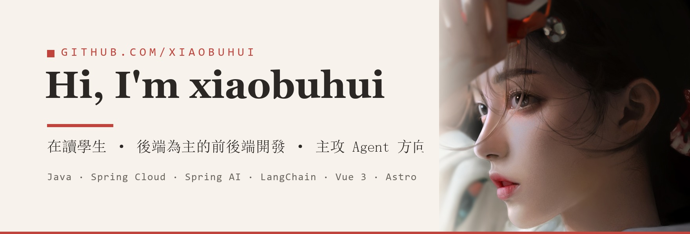

  <a href="./README.md">简体中文</a> · <a href="./README.en.md">English</a> · <b>繁體中文</b> · <a href="./README.ja.md">日本語</a> · <a href="./README.ko.md">한국어</a> · <a href="./README.ru.md">Русский</a> · <a href="./README.es.md">Español</a> · <a href="./README.fr.md">Français</a> · <a href="./README.de.md">Deutsch</a> · <a href="./README.pt.md">Português</a>

  
  

我是 xiaobuhui，在讀學生，後端為主的前後端開發。白天上課，晚上寫程式，手上幾個專案基本都是這樣累積出來的。

後端是我最扎實的一塊。從 SSM 起步，Spring Boot、Spring Cloud 一路做下來，註冊中心、閘道、分散式交易這些都在實際專案裡落地過。

現在的方向是 AI 應用與 Agent 開發，主要工具是 Spring AI、LangChain、LangGraph，搭配 Python / FastAPI 實作。

前後端這塊我都能獨立落地。前端以 Vue 3 / Astro 為主，搭配 TypeScript 和 Tailwind CSS，能從 API 一路做到頁面。

---

## 在做什麼

目前把大部分時間投在 Agent 方向：一邊補工具呼叫、RAG、評估這些基礎，一邊用 Python 把想法做成能跑的東西。

手上比較完整的兩個專案都是前後端分離、從零搭起來的。CloudShopping 是 Vue 3 + Spring Cloud Alibaba 的 B2C 電商平台，含 Nacos 服務治理、Dubbo 遠端呼叫、Seata 分散式交易；LiangtianDigitalFarm 是 Spring Boot 3 的智慧農業平台，涵蓋種植到銷售全流程，接入了物聯網環境監測與遠端控制。

另外自己架了一個 Astro 部落格，用來沉澱技術筆記。

---

## 技術棧

| 方向 | 技術棧 | 定位 |
| --- | --- | --- |
| AI / Agent | `Spring AI` `LangChain` `LangGraph` `LangSmith` `Python` `FastAPI` | 當前主攻方向 |
| 後端 | `Java` `Spring Boot` `Spring Cloud` `MyBatis-Plus` `Dubbo` | 核心能力，多個完整專案 |
| 中介軟體 | `Nacos` `Seata` `RocketMQ` `Redis` `Sentinel` `Elasticsearch` | 專案實戰配置 |
| 資料庫 | `MySQL` `Redis` `SQLite` | 設計與使用 |
| 前端 | `Vue 3` `Astro` `Svelte` `TypeScript` `Tailwind CSS` | 可獨立完成前後端全鏈路 |
| 維運 | `Linux` `Docker` `Nginx` | 容器化部署 |

---

  歡迎交流 Java 後端、微服務與 Agent 開發

